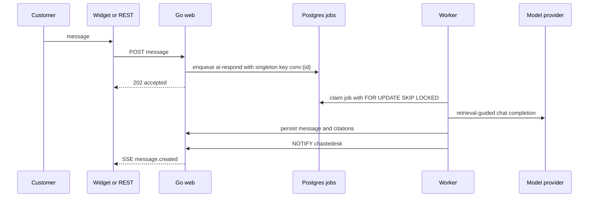

# Architecture

ChasteDesk is a single Go module with three binaries and one stateful dependency: Postgres 16 with pgvector. The design favors explicit boundaries, server-rendered pages, and plain SQL over framework magic.

## Processes

| Binary | Responsibility |
| --- | --- |
| `cmd/web` | HTTP API, dashboard, widget endpoints, SSE streams, session auth, migrations on boot |
| `cmd/worker` | URL and file ingestion, embedding, AI response jobs, action execution, analytics rollups |
| `cmd/migrate` | One-shot migration runner used by Compose |

`cmd/web` and `cmd/worker` both call `db.Migrate` or rely on the migrate service. Migrations are embedded from `internal/db/migrations` and recorded in `schema_migrations`.

## Request flow

The dashboard uses the same path for human replies and approvals. Approvals are a database row plus a queued `execute-action` job.

## Data model

All domain tables carry `org_id`. Repository methods require `db.RepoCtx`, which is only constructed through `db.WithOrg`. Client payloads never supply `org_id`.

Core tables:

| Table | Role |
| --- | --- |
| `organization`, `member`, `user`, `account`, `session` | Single-organization auth and membership |
| `invitation` | One-time invite links with role and expiry |
| `customers` | Customer profile and attributes, unique by lowercased email per organization |
| `conversations` | Channel, status, triage, handoff package, response and resolution timestamps |
| `messages` | Customer, AI, human, internal note, or system messages with optional citations |
| `knowledge_sources` | URL, file, or pasted text sources with scope, status, version, and error |
| `knowledge_chunks` | Chunk content, locator, token count, embedding, generated `tsv` |
| `agents` | Active support agent and its JSON policy |
| `provider_configs` | Encrypted provider credentials, base URL, model cache |
| `api_keys` | Hashed REST keys with prefix and last-used timestamp |
| `actions` | Approval-required tool calls, decisions, results, verification |
| `ai_runs` | One agent run with steps, evidence, usage, and outcome |
| `audit_events` | Append-only security log with update and delete triggers |
| `widget_configs` | Origins, enabled flag, theme |
| `analytics_daily` | Per-day metric rollups |
| `jobs` | Postgres-backed queue with retries, singleton keys, and run times |
| `rate_limit_windows` | Fixed-window counters for login, setup, invite, widget, API |

`knowledge_chunks.embedding` has no vector typmod. The current engine stores the model name alongside each embedding and only compares vectors produced by the same model.

## Authentication and authorization

Passwords are hashed with Argon2id (64 MiB, 3 iterations, 2 lanes). Sessions are random 32-byte tokens stored as SHA-256 hashes in `session`, sent in an `HttpOnly`, `SameSite=Lax` cookie. The cookie is `Secure` when `APP_URL` starts with `https://`.

Capabilities are defined in `internal/auth/rbac.go`:

| Capability | Owner | Admin | Agent |
| --- | --- | --- | --- |
| `settings.read` / `settings.write` | yes | yes | no |
| `knowledge.read` | yes | yes | yes |
| `knowledge.write` | yes | yes | no |
| `audit.read` | yes | yes | no |
| `inbox.use` | yes | yes | yes |
| `org.admin` | yes | no | no |

Invitations are single-use links. The invitation ID is a 192-bit random token stored in the `invitation` table. Accepting an invitation creates the user, credential account, and membership in one transaction.

## Retrieval

Ingestion is structure-aware:

1. Fetch or read the source.
2. Strip non-content HTML, preserve headings and tables.
3. Split on heading boundaries, target 500 to 800 tokens, 80-token overlap.
4. Record a heading breadcrumb and character range in `locator`.
5. Insert chunks with a generated `tsv`. Embeddings are stored when a provider supports them.

Search runs two ranked queries:

- Full-text: `tsv @@ websearch_to_tsquery('simple', $1)` ranked with `ts_rank_cd`, top 50.
- Vector: cosine distance over chunks whose `embedding_model` matches the requested model, top 50.

Reciprocal rank fusion combines them: `score = sum(1 / (60 + rank))`. Confidence is `clamp01(score / (score + 0.02))`. When no embedding exists, vector search is skipped and the engine degrades to FTS only.

## Agent loop

The active agent policy controls purpose, knowledge scopes, per-tool modes, escalation settings, model choice, and budgets.

For each customer message:

1. Load conversation, customer, history, and policy.
2. Retrieve evidence from the allowed scopes.
3. Run the model with tool declarations. Every tool call is resolved against the policy before execution.
4. Append an audited step for each model turn and tool call.
5. Parse citations. An answer without a valid `[E#]` citation gets one stricter retry, then escalates.
6. Stop on any escalation trigger: keyword, explicit human request, low confidence, denied tool, budget exhaustion, missing citations, or tool failure.
7. Persist the answer with citations, emit SSE, write audit rows.

Approval-required tools create an `actions` row, set the run to `awaiting_approval`, send a holding message, and end the job. Approval queues execution. The execution job verifies the tool result before a customer-facing success message is allowed. Verification failure escalates.

## Queue

The queue is a table, not an external broker. Workers claim one job at a time with `FOR UPDATE SKIP LOCKED`, update status to `active`, run the handler, then mark it complete, retry, or failed. `singleton_key` prevents duplicate concurrent work for a conversation, source, action, or rollout.

Queues in the current build:

- `ingest-url`
- `ingest-file`
- `ingest-text`
- `ai-respond`
- `execute-action`
- `analytics-rollup`

## Real-time updates

Postgres `LISTEN/NOTIFY` carries small event envelopes on the `chastedesk` channel. The web process holds a dedicated connection per SSE stream, filters by organization and conversation, and sends heartbeats every 15 seconds. Streams have a 10-minute lifetime; EventSource reconnects automatically.

Widget streams emit `message`, `action.pending`, `ready`, and `ping` frames. Dashboard streams feed list and thread refreshes through HTMX custom events.

## Web UI

- `internal/web/views/*.templ` holds page and component templates. Generated `*_templ.go` files are committed.
- `internal/web/static/css/tokens.css` defines the design tokens.
- `internal/web/static/css/app.css` holds layout, components, and responsive rules.
- `internal/web/static/js/app.js` handles the mobile navigation, command palette, copy buttons, composer modes, and SSE-triggered HTMX refreshes.
- `internal/web/static/htmx.min.js` is vendored.
- Fonts are self-hosted. No third-party scripts run in the dashboard.
- The widget is a single IIFE with a closed Shadow DOM, so host page CSS does not leak in.

See [design.md](../design.md) for the design system and [DEVELOPMENT.md](DEVELOPMENT.md) for the implementation workflow.

## Security boundaries

- The web process trusts only session cookies, API key hashes, and HMAC-signed widget tokens.
- Widget requests must present a token whose payload includes the allowed origins, and the request `Origin` must match one of them.
- Unsafe cookie-authenticated requests reject cross-site `Origin` and `Sec-Fetch-Site` values.
- The crawler validates all resolved addresses and redirect targets against private ranges.
- Provider secrets are encrypted with AES-256-GCM using HKDF-derived keys.
- The audit table rejects update and delete at the database level.
- CSP, frame denial, nosniff, referrer policy, and HSTS on TLS are applied globally.

Details and operator guidance: [SECURITY.md](SECURITY.md).

## Known constraints

- Single organization per installation.
- No email delivery. Invitations are copyable links.
- One URL per knowledge source. Site-wide crawling is not implemented.
- No ANN index for vectors at M1 scale. Search is exact cosine over the filtered candidate set.
- Analytics rollups are daily UTC windows, not a live event stream.
- The frozen `apps/` and `packages/` directories are reference material, not part of the runtime.
